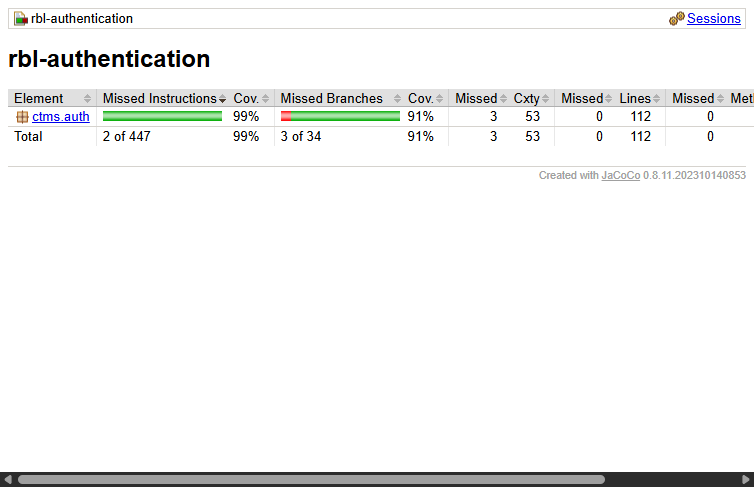
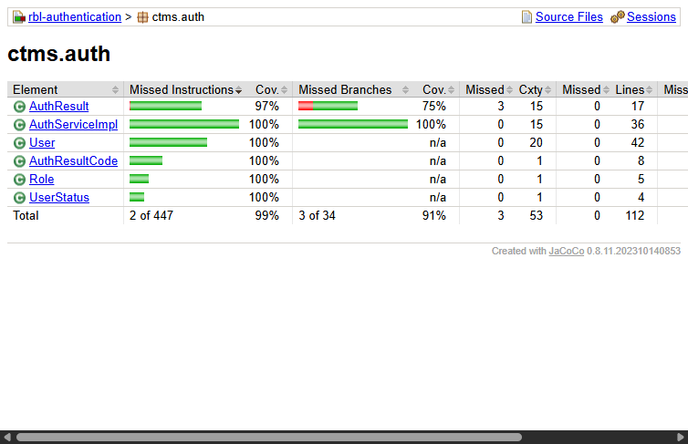

# RBL - Unit Testing Authentication Module cho Container Terminal Management System (CTMS)

**Học viên:** Cao Đức Tiến  
**Mã số sinh viên (MSSV):** DE190608  
**Môn học:** SWT301 - Software Testing  
**Chủ đề Research by Learning (RBL):** Thiết kế và cài đặt Unit Test cho chức năng Xác thực (Authentication & RBAC) của hệ thống Quản lý Cảng Container (CTMS).

---

## 1. Bối cảnh hệ thống & Ma trận phân quyền 4 Actors

Hệ thống **Container Terminal Management System (CTMS)** phục vụ 4 nhóm đối tượng chính với các quyền truy cập độc lập:

| Actor | Quyền truy cập sau khi xác thực thành công |
|---|---|
| **Manager** | • Authenticate User (Login / Logout)<br>• View Dashboard (thống kê toàn cảng)<br>• Manage Shipping Lines (hãng tàu)<br>• Manage Vessels (đội tàu)<br>• Assign Vessel to Berth (chỉ định cầu bến) |
| **Terminal Operator** | • Authenticate User (Login / Logout)<br>• View Dashboard<br>• Manage Containers & Search/Filter<br>• View Movement History & View Yard<br>• Assign Container to Slot & Move Container<br>• View Gate Appointments<br>• Confirm Gate In & Confirm Gate Out |
| **Shipping Line Staff** | • Authenticate User (Login / Logout)<br>• View Shipping Line Information<br>• View Vessel Schedule<br>• Manage Containers & Search/Filter<br>• Book Import Drop-off Appointment<br>• Book Export Pickup Appointment<br>• View Gate Appointments |
| **Truck Driver** | • Authenticate User (Login / Logout)<br>• View Gate Appointments (xem lịch hẹn giao nhận container tại cổng) |

---

## 2. Đặc tả Business Logic (Quy tắc nghiệp vụ)

* **BR-AUTH-01 (Input Validation):** Username và Password không được null, rỗng hoặc chỉ chứa khoảng trắng (`blank`). Trả về `INVALID_INPUT` mà không cần truy vấn Database.
* **BR-AUTH-02 (Chuẩn hóa ký tự):** Username không phân biệt hoa thường (`toLowerCase(Locale.ROOT)`). Password phân biệt hoa thường (`case-sensitive`).
* **BR-AUTH-03 (Chống User Enumeration Attack):** Khi username không tồn tại hoặc sai mật khẩu, trả về chung một mã lỗi `INVALID_CREDENTIALS` để bảo vệ an ninh.
* **BR-AUTH-04 (Tài khoản Disabled):** Nếu tài khoản có trạng thái `DISABLED` $\rightarrow$ chặn đăng nhập ngay, trả về `ACCOUNT_DISABLED`.
* **BR-AUTH-05 (Tài khoản đang bị khóa):** Nếu cờ `isLocked = true` $\rightarrow$ trả về `ACCOUNT_LOCKED`, không tăng bộ đếm số lần sai.
* **BR-AUTH-06 (Bảo vệ Brute-force / Khóa sau 5 lần sai):** 
  * Sai từ 1 đến 4 lần: Tăng `failedAttempts` thêm 1 và trả về `INVALID_CREDENTIALS`.
  * Sai đúng lần thứ 5: Tự động khóa tài khoản (`isLocked = true`, `status = LOCKED`) và trả về `ACCOUNT_LOCKED`.
* **BR-AUTH-07 (Đăng nhập thành công):** Reset `failedAttempts = 0`, ghi nhận `lastLoginAt`, cấp phát JWT Token chứa đúng Claim Role của Actor và trả về `SUCCESS`.
* **BR-AUTH-08 & BR-AUTH-09 (Đăng xuất):** Token rỗng hoặc hết hạn $\rightarrow$ trả về `INVALID_TOKEN`. Token hợp lệ $\rightarrow$ đưa vào danh sách thu hồi (Invalidate) và trả về `LOGOUT_SUCCESS`.

---

## 3. Bảng quyết định (Decision Table) cho phương thức `login()`

| Điều kiện / Quy tắc | R1 | R2 | R3 | R4 | R5 | R6 |
|---|---|---|---|---|---|---|
| User tồn tại trong DB? | N | Y | Y | Y | Y | Y |
| Trạng thái DISABLED? | – | Y | N | N | N | N |
| Đang bị khóa (`isLocked`)? | – | – | Y | N | N | N |
| Mật khẩu trùng khớp? | – | – | – | N | N | Y |
| Đã sai 4 lần trước đó? | – | – | – | N | Y | – |
| **Kết quả mong đợi** | `INVALID_CREDENTIALS` | `ACCOUNT_DISABLED` | `ACCOUNT_LOCKED` | `INVALID_CREDENTIALS`<br>(counter + 1) | `ACCOUNT_LOCKED`<br>(counter = 5, lock) | `SUCCESS`<br>(counter = 0, cấp Token) |

---

## 4. Danh sách các Test Cases áp dụng (Test Matrix)

| Mã TC | Phương thức Test | Kịch bản kiểm thử | Input | Expected Output | Kỹ thuật áp dụng |
|---|---|---|---|---|---|
| **TC01** | `login_NullOrBlankUsername_ReturnsInvalidInput` | Username null/rỗng | `username = "" / null`, `pass = "Secret@123"` | `INVALID_INPUT` | Equivalence Partitioning (EP) |
| **TC02** | `login_NullOrBlankPassword_ReturnsInvalidInput` | Password null/rỗng | `username = "operator_01"`, `pass = ""` | `INVALID_INPUT` | EP |
| **TC03** | `login_NonExistentUser_ReturnsInvalidCredentials` | User không có trong DB | `username = "ghost"`, `pass = "Secret@123"` | `INVALID_CREDENTIALS` | Decision Table R1 |
| **TC04** | `login_DisabledAccount_ReturnsAccountDisabled` | Tài khoản bị Disabled | User status = `DISABLED` | `ACCOUNT_DISABLED` | Decision Table R2 |
| **TC05** | `login_AlreadyLockedAccount_ReturnsAccountLocked...` | Đang bị khóa nhập pass | User `isLocked = true` | `ACCOUNT_LOCKED`, counter giữ nguyên | Decision Table R3 |
| **TC06** | `login_WrongPasswordUnderThreshold_Increments...` | Sai pass lần 1..4 | Sai pass 1..4 lần | `INVALID_CREDENTIALS`, counter +1 | State Transition / BVA |
| **TC07** | `login_WrongPassword5thTime_LocksAccount` | Sai pass đúng lần thứ 5 | Sai pass lần 5 | `ACCOUNT_LOCKED`, `isLocked = true` | Boundary Value Analysis (Biên 5) |
| **TC08** | `login_CorrectCredentials_ResetsFailedAttempts...` | Đúng pass sau các lần sai | Từng sai 3 lần, lần 4 nhập đúng | `SUCCESS`, counter reset về 0 | State Transition |
| **TC09** | `login_UsernameCaseInsensitive_ReturnsSuccess` | Username hoa thường khác nhau | `"operator_01"`, `"OPERATOR_01"` | Đều `SUCCESS` | EP |
| **TC10** | `login_PasswordCaseSensitive_WrongCaseReturnsError` | Password sai chữ hoa thường | Password đổi case | `INVALID_CREDENTIALS` | EP |
| **TC11** | `login_DifferentActors_ReturnsTokenWithCorrectRole` | Manager đăng nhập | User Role = `MANAGER` | `SUCCESS`, token claim `MANAGER` | Role-based Auth |
| **TC12** | `login_DifferentActors_ReturnsTokenWithCorrectRole` | Operator đăng nhập | User Role = `TERMINAL_OPERATOR` | `SUCCESS`, token claim `TERMINAL_OPERATOR` | Role-based Auth |
| **TC13** | `login_DifferentActors_ReturnsTokenWithCorrectRole` | Shipping Line Staff đăng nhập | User Role = `SHIPPING_LINE_STAFF` | `SUCCESS`, token claim `SHIPPING_LINE_STAFF` | Role-based Auth |
| **TC14** | `login_DifferentActors_ReturnsTokenWithCorrectRole` | Truck Driver đăng nhập | User Role = `TRUCK_DRIVER` | `SUCCESS`, token claim `TRUCK_DRIVER` | Role-based Auth |
| **TC15** | `logout_ValidToken_ReturnsSuccess` | Đăng xuất với token hợp lệ | Token đang hoạt động | `LOGOUT_SUCCESS`, token bị vô hiệu hóa | State Transition |
| **TC16** | `logout_NullOrBlankToken_ReturnsInvalidToken` | Đăng xuất token rỗng/hết hạn | `token = null / expired` | `INVALID_TOKEN` | EP |

---

## 5. Hướng dẫn chạy kiểm thử & Đo Code Coverage

Chạy toàn bộ test suite và sinh báo cáo JaCoCo coverage:
```bash
mvn clean test jacoco:report
```
Báo cáo coverage HTML nằm tại:
`target/site/jacoco/index.html`

### 5.1 Thống kê kết quả kiểm thử (Test Metrics)
* **Tổng số test methods / invocations:** **34 test runs (100% Passed, 0 Failures, 0 Errors, 0 Skipped)**
* **JaCoCo Coverage toàn module:**
  * **Line Coverage: 100%** (112/112 dòng)
  * **Branch Coverage: 91%** (31/34 nhánh)
  * **Lớp nghiệp vụ chính `AuthServiceImpl`:** **Line 100% (36/36), Branch 100% (22/22)**

### 5.2 Ảnh chụp báo cáo JaCoCo Coverage



---

## 6. Kết quả Mutation Testing thủ công (3 Lỗi giả lập)

| # | Mutant | Vị trí sửa trong Code Production | Test Case bắt lỗi (Killed By) | Trạng thái |
|---|---|---|---|---|
| **M1** | Sửa điều kiện khóa tài khoản | Sửa `>= MAX_FAILED_ATTEMPTS` thành `> MAX_FAILED_ATTEMPTS` | `LoginDecisionTableTests.login_WrongPassword5thTime_LocksAccount` | **KILLED** (Báo FAIL vì lần thứ 5 chưa khóa) |
| **M2** | Bỏ qua việc reset bộ đếm khi đăng nhập đúng | Xóa dòng `user.resetFailedAttempts();` | `LoginDecisionTableTests.login_CorrectCredentials_ResetsFailedAttemptsAndReturnsSuccess` | **KILLED** (Báo FAIL vì counter không về 0) |
| **M3** | Bỏ qua kiểm tra tài khoản vô hiệu hóa | Bỏ khối `if (user.getStatus() == UserStatus.DISABLED)` | `LoginDecisionTableTests.login_DisabledAccount_ReturnsAccountDisabled` | **KILLED** (Báo FAIL vì tài khoản disabled vẫn được phép đăng nhập) |

> *Toàn bộ 3 mutant đã được hoàn tác về code chuẩn ban đầu.*